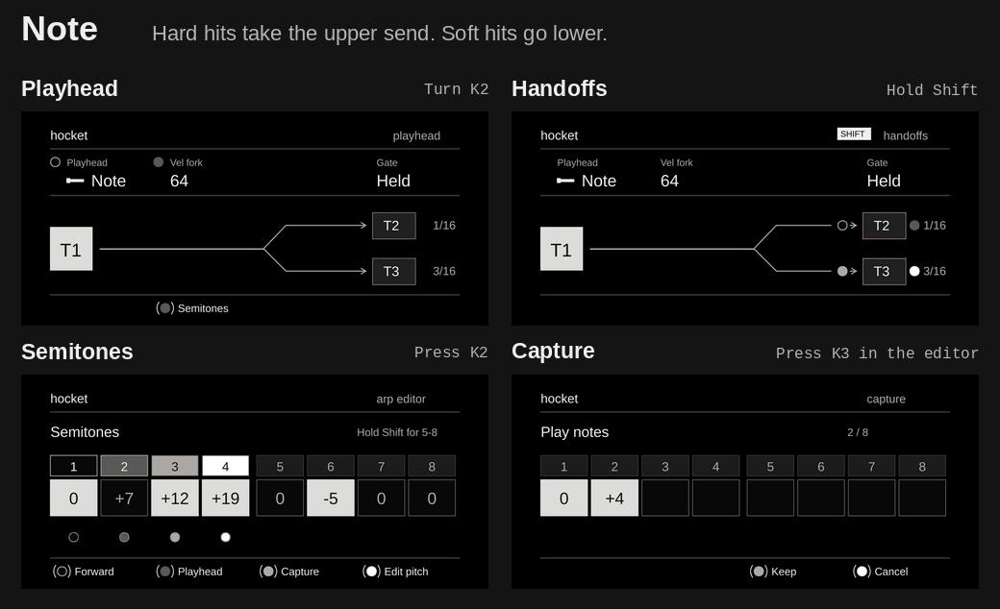

# Hocket

Hocket is a note player for the **Teenage Engineering OP-XY**. Play or sequence a note on one instrument track and let another answer with its own sound. You can **chain all eight instrument tracks** when Hocket is active on each one. Each track can send to two destinations, with a separate delay for each send.


In this example, all eight tracks use **Note**. T1 sends to T2, T2 sends to T3, and so on. With a 1/16 delay at each hop, T8 plays seven sixteenths after T1. Try a different instrument on each track to hear the note move.

**[Illustrated player manual (PDF)](docs/Hocket-Manual.pdf)** · **[Release notes](RELEASE.md)**

## Install with TE Builder

1. Download the Hocket release ZIP, or use **Code → Download ZIP** on GitHub.
2. In TE Builder, use **File → Import Machine ZIP…** and choose that ZIP.
3. Select your XY, add **Hocket** from the available machines, and build. This release targets **OP-XY OS 1.2.1** and uses the Open-XY revision pinned in the bundle. Use your configured Blackfin toolchain.
4. Stage the completed build on that XY and complete the normal firmware installation. After boot, open an instrument track’s **player/arp selector** and choose **Hocket**.

## Make your first handoff

1. Put different sounds on **T1** and **T2** so you can hear which track is playing. Select Hocket as the player on both.
2. On **T2**, turn **K1** to **Arp**. The starting grid plays offsets of **0, +7, +12, +19** semitones. Keep both sends Off.
3. On **T1**, turn **K1** to **Note**. Hold **Shift**, turn **K1** to select **T2**, and leave **K2** at **1/16**. Release Shift.
4. Hold C on T1. Its instrument sustains C. One sixteenth later, T2 starts its four-note phrase. For a continuous answer, press **K3** on T2’s playhead until it reads **Repeat**, then hold C again.

## Chain or split the route

Start anywhere in the chain. Choose Hocket in the player/arp selector on every track you want to participate, then set each sender’s destinations under **Shift**. Sends start **Off**. To recreate the animation, use only the upper send on T1–T7, leave both sends Off on T8, and leave **Vel fork** Off throughout.

For a split, try **T1 Note → T2 Arp** on the upper send and **T1 Note → T3 Spray** on the lower. Set T1’s **Vel fork** to 64. A hard accent starts the arpeggio, and a soft touch starts the cloud. Either receiver can send onward. On Arp and Spray, **Root** hands off the incoming note once. **Steps** hands off each sounding pitch with its gate and timing.

## Choose what travels

| Playhead | What you hear | A useful gesture |
| --- | --- | --- |
| **Note** | One sustained note following the incoming gate. | Turn **K2** for **Vel fork**. Hard hits take the upper send, soft hits the lower. |
| **Arp** | A phrase of up to eight editable semitone offsets, with rests and shuffle. | Turn **K2** for **Swing**. Choose **Steps** to pass the swung attacks on. |
| **Spray** | Repeated hits drawn from the enabled pitches. Releasing the key starts a timed fade. | Turn **K2** for **Nudge**. Press **K3** to choose a tail of up to five seconds. |

In **Note**, Vel fork defaults to **Off**, which sends to both destinations. Set it to **64** to send velocities 64–127 up and 1–63 down. Split points run from 16 to 120 in steps of eight. The fork compares the incoming note-on velocity. Instrument sensitivity can stay at zero. Each branch keeps its own delay. If the selected branch is Off, only the local note plays.

In **Arp**, Swing moves every other time slot by **−95% to +95% of one Rate step**. Zero is straight. Negative values rush the offbeat and positive values drag it. Try **+34%** for a triplet feel. Rests count in Rest mode and an odd-length repeat carries the swing across the wrap.

In **Spray**, pitches come from the semitone editor. **Nudge** ranges from 0–100% in 5% steps. At full depth, each hit after the first can rush or drag by up to half a Rate step. Offsets are relative to the grid, so the phrase stays in time. **Steps** forwards the timing you hear plus the branch delay. Turn K2 while holding a phrase to change the timing of upcoming steps. A hit already scheduled keeps its deadline.

**Shift** on the playhead reveals the two destinations and their independent delays. **Press K2** to open the eight-slot editor. Turn K1–K4 for slots 1–4, or hold Shift for 5–8. Press K3 there to capture notes from the keyboard.

On the Arp and Spray playheads, turn **K3** for rates from **1/32 to 1/2**. A trailing dot means dotted (one and a half times the straight value). Turn **K4** for **5–100% gate**, in **5%** steps. Note mode follows the incoming gate.

The eight columns show the phrase from left to right. The vertical scale fits the lowest and highest enabled pitches and prints each used semitone offset once. When nearby pitches crowd the scale, short lines connect the labels to their true heights. A single enabled pitch sits in the middle.



## Save and share a project

Save normally on the XY. Hocket recalls the sends, delays, committed grid and playback options for each instrument track. When copying a project or workspace, keep its matching **.xy** and **.oxy** files together. Press **Keep** in the editor to include a recorded take.

Stock track linking can trigger a player independently of a Hocket handoff. If you hear an unexpected double attack, try the same passage with stock linking off. A handoff path visits a given track once. **Repeat** on an Arp track is the control for a phrase that cycles while held.

## Source and checks

The [machine source](hocket/) implements the playheads and scheduling. The [bundle manifest](machine-bundle.json) declares the pinned SDK commit, patch order and hashes that TE Builder uses. The two patches are included at the repository root. The Open-XY license notice is included in [OPEN-XY-LICENSE](OPEN-XY-LICENSE).

With the bundle’s patches applied to the pinned SDK, run the host checks from the repository root. Substitute your checkout path for `/path/to/open-xy`.

```sh
python3 checks/clocked_playback.py --sdk /path/to/open-xy
python3 checks/project_state.py --sdk /path/to/open-xy
```
