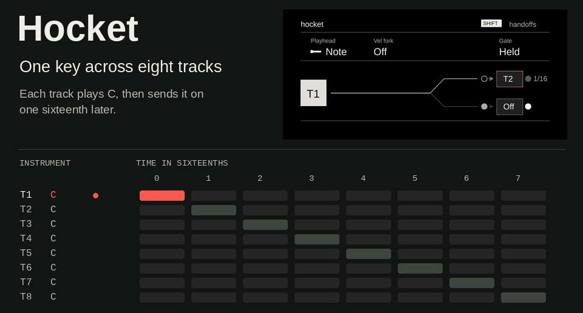

# Hocket

A note player for the **Teenage Engineering OP-XY**. Play a key or sequence a note on one instrument track and let up to two other tracks answer. All 8 tracks can be chained together! Each receiver plays its own instrument and can pass the phrase on. A bass can hold the root while a second track picks out an arpeggio and a third scatters the same notes into a fading tail.



The animation follows a single C through three tracks. T1 plays **C–G–C–G** in eighth notes with **Steps** selected. T2 and T3 are in **Note** mode, so each plays the pitches it receives at its own delay. The score beneath the panel shows each trigger in slow motion.

**[Read the illustrated Hocket manual (PDF)](docs/Hocket-Manual.pdf)**

## Install with TE Builder

1. Download the source from GitHub using **Code → Download ZIP**.
2. In TE Builder, use **File → Import Machine ZIP…** and choose that ZIP.
3. Select your XY, add **Hocket** from the available machines, and build. This release targets **OP-XY OS 1.2.1** and uses the Open-XY revision pinned in the bundle. Use your configured Blackfin toolchain.
4. Stage the completed build on that XY and complete the normal firmware installation. After boot, open an instrument track’s **player/arp selector** and choose **Hocket**.

## Make your first handoff

1. Put different sounds on **T1** and **T2** so you can hear which track is playing. Select Hocket as the player on both.
2. On **T2**, turn **K1** to **Arp**. The starting grid plays offsets of **0, +7, +12, +19** semitones. Keep both sends Off.
3. On **T1**, turn **K1** to **Note**. Hold **Shift**, turn **K1** to select **T2**, and leave **K2** at **1/16**. Release Shift.
4. Hold C on T1. Its instrument sustains C. One sixteenth later, T2 starts its four-note phrase. For a continuous answer, press **K3** on T2’s playhead until it reads **Repeat**, then hold C again.

## Choose what travels

| Playhead | What you hear | A useful gesture |
| --- | --- | --- |
| **Note** | One sustained note following the incoming gate. | Give a second instrument a delayed attack. |
| **Arp** | A phrase of up to eight editable semitone offsets, with rests and shuffle. | Choose **Steps** to send the pitches of the phrase to another track. |
| **Spray** | Repeated hits drawn from the enabled pitches. Releasing the key starts a timed fade. | Transpose with **K2** and press **K3** to choose a tail of up to five seconds. |

**Shift** on the playhead reveals the two destinations and their independent delays. **Press K2** to open the eight-slot editor. Turn K1–K4 for slots 1–4, or hold Shift for 5–8. Press K3 there to capture notes from the keyboard.

## Save and share a project

Save normally on the XY. Hocket recalls the sends, delays, committed grid and playback options for each instrument track. When copying a project or workspace, keep its matching **.xy** and **.oxy** files together. Press **Keep** in the editor to include a recorded take.

Stock track linking can trigger a player independently of a Hocket handoff. If you hear an unexpected double attack, try the same passage with stock linking off. A handoff path visits a given track once. **Repeat** on an Arp track is the control for a phrase that cycles while held.

## Source and checks

The [machine source](hocket/) implements the playheads and scheduling. The [bundle manifest](machine-bundle.json) declares the pinned SDK commit, patch order and hashes that TE Builder uses. The two patches are included at the repository root. The Open-XY license notice is included in [OPEN-XY-LICENSE](OPEN-XY-LICENSE).

With the bundle’s patches applied to the pinned SDK, run the host checks from the repository root. Substitute your checkout path for `/path/to/open-xy`.

```sh
python3 checks/clocked_playback.py --sdk /path/to/open-xy
python3 checks/project_state.py --sdk /path/to/open-xy
```

**0.1.22** fixes a project-recall bug that could leave both sends Off after reopening a project or restarting the XY. Set your routes and save once with this version. Projects that already contain valid Hocket settings can recall them directly. Older saves that omitted the settings need their routes entered again.
